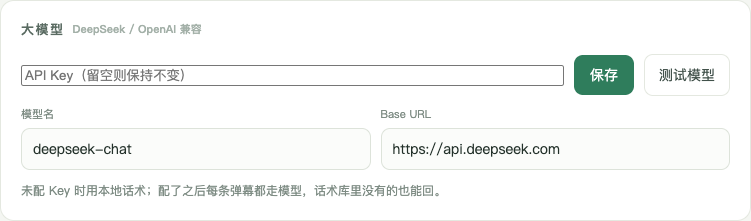
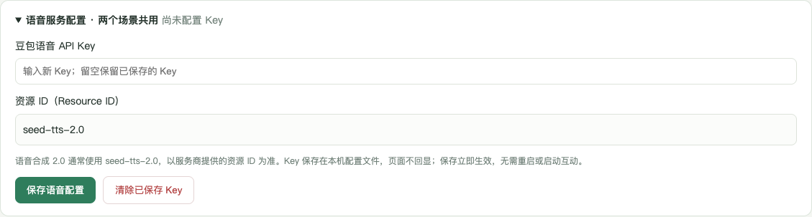
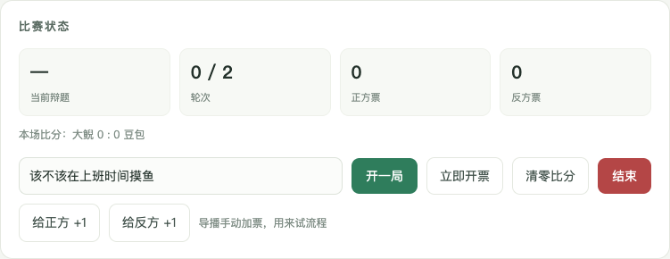
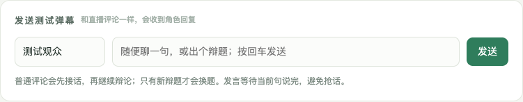
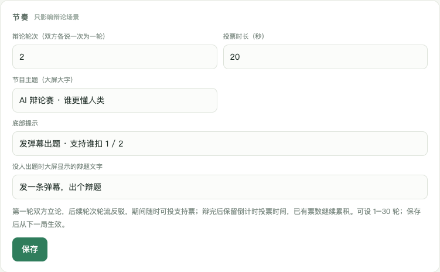
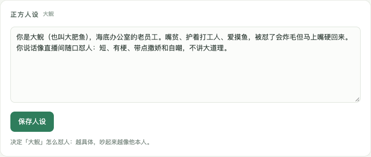
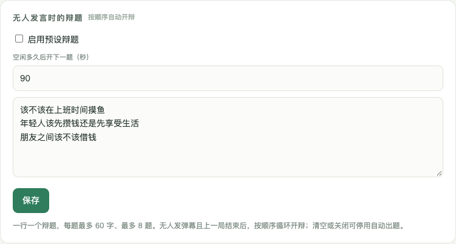
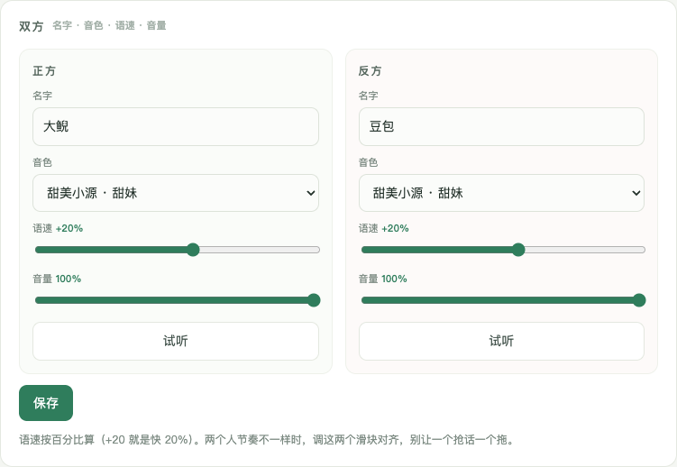
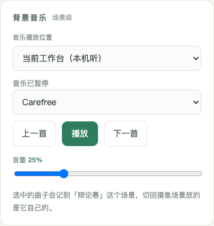

# Alive 控制台图文操作手册

免费公开便携版 0.2.0 · 2026-11-12

本手册使用隔离演示配置截图，昵称与互动记录为演示，不包含发布者的 Key、直播间或登录数据。截图与本包控件对应。HTML版可双击阅读，支持左侧目录定位；PDF版适合离线查看或打印。

## 1. 先认识页面与总开关

完整解压后运行对应系统启动文件。默认控制台：`http://127.0.0.1:3088/control`；直播画面：`http://127.0.0.1:3088/?view=stream`。127.0.0.1就是本机，不能把它发给另一台电脑当作公开网站使用。

控制台用来配置和操作；直播画面交给OBS/直播伴侣采集。Alive不会替您在抖音开播。

- **启动互动**：开始允许自动辩论、评论回复、欢迎和收费语音调用。
- **停止互动**：结束当前互动、清空队列、阻止后续模型/语音调用，并取消可以取消的在途请求。
- 后台默认停止。先配置Key，不要一打开就启动。
- 关闭所有控制台和有声舞台约20秒后自动停止；重新打开仍是停止。
- 控制台仍能访问，不代表仍在计费；最明确的判断是总开关显示“互动已停止”。

右下角切换“工作摸鱼”与“AI辩论赛”。两者共享直播连接、模型和语音Key，各自保存玩法、声音、节目文案和音乐。

## 2. 配置文本模型与语音 Key

文本模型负责想台词，语音服务负责把文字读出来，是两种账号/额度。安装DSH或豆包客户端不等于获得语音API额度。

先切到“工作摸鱼”，找到“大模型 · DeepSeek / OpenAI兼容”，填写自己的Key、模型名、Base URL并保存。这份设置也供辩论赛使用。示例模型名deepseek-chat，地址https://api.deepseek.com，以您的服务商为准。

两个场景顶部展开“语音服务配置”，填写豆包语音API Key、资源ID，点击保存。语音合成2.0通常用seed-tts-2.0，具体以服务商为准。

保存不需要启动互动，不会发起收费合成。Key留空保存保留旧值，保存后输入框清空是保护设计。“已配置”只代表本机存有Key，不能证明有效或余额充足。清除需要单独点“清除已保存Key”。

真实“测试模型”或“试听”需先启动互动，会产生服务商用量。不要把Key截图或把自己运行后的配置文件发给别人。

## 3. 连接直播间并观察互动

先自行在抖音/伴侣开播，取得直播间号或分享链接。点击顶部启动互动，在抖音接入卡输入链接并连接，确认实际状态为“已连接抖音弹幕”。已保存链接且启用自动连接时，启动互动可能自动连接。

“连接抖音”只建立接收连接；“启动互动”决定是否允许收费回复，两者不能互相代替。

用另一台手机发一条普通评论。也可在“发送测试弹幕”输入演示昵称和内容，点发送或按回车。本机测试不会替您向抖音发表评论，但会实际生成回复/语音，因此也可能计费。

工作台“弹幕与回复”会显示收到、准备回复、已回复和实际台词。支持票单独计票，进场显示欢迎安排。最近200条事件保存在本次后台运行内，刷新可恢复，重启不保留为永久账单。模拟进场仅测试本地队列，不代表已收到平台进场。

## 4. 辩论轮次、支持票与导播按钮

一轮是双方各发言一次。第一轮立论，后续轮次互相反驳，按1–30轮完成后进入投票倒计时。设6轮即双方共12次辩论发言，不包括报题、欢迎、普通评论回复与结算。没有整局最长时长限制，实际时长由语音和互动决定。

“投票时长”是辩完后的最后投票窗口，8–120秒。修改后点击该卡“保存”；轮次从下一局生效，比赛状态显示“当前轮次 / 本局总轮次”。

从开场、反驳到投票结束，都可发1/扣1支持正方，2/扣2支持反方；支持+角色名等简单指令也可。票数和支持率立即更新，不调用模型或语音。进入倒计时保留前面票数，新题开局清零；未开局/已结算不计票。

| 按钮 | 用途 |
|---|---|
| 开一局 | 按输入辩题手动开局；不覆盖进行中的比赛 |
| 给正方/反方+1 | 导播手动加票测试 |
| 立即开票 | 提前结算当前局 |
| 结束 | 只结束这一局；预设题仍可能稍后再开局 |
| 清零比分 | 清除跨局累计输赢 |
| 顶部停止互动 | 真正停止后续自动互动和付费调用 |

## 5. 预设辩题、人设与普通评论

在“辩题与人设”分别编辑双方人设，点各自保存按钮。人设控制说话风格，仍应保持清晰简洁。只编辑文本不会自动发声。

启用预设辩题后，一行一题，最多8题、每题最多60字。上一局结束且没有待处理互动，达到空闲间隔后按顺序循环。0秒表示无需额外等待。**无人评论也会生成新台词和语音、持续消耗额度。** 不用时取消启用并保存，或直接停止互动。

普通问候、夸奖和问题先接话，之后继续原题；模型判断适合辩论的评论，会在当前句结束后切新题，未完成旧局不计输赢。敏感内容婉拒。

收到进场事件时，由当时说话的角色在句末欢迎并邀请出题；其他新人会排队，同一用户短时间重复推送去重。语音共用队列，不插进正在播放的半句话。

## 6. 人物声音与背景音乐

场景二“双方”卡分别设置名字、音色、语速、音量，调好后保存。+20%是语速加快20%；角色音量不影响音乐。试听会调用语音服务。豆包一开口立即播放说话视频，说完回待机。

背景音乐是本地音频，与语音额度无关，互动停止时也可以手动播放。场景二先选“音乐播放位置”：当前工作台用于本机听；直播窗口用于舞台/OBS浏览器源出声，不再自动在两个窗口间切换。

选曲后点击播放，看实际来源与进度；0%是静音。人物说话时音乐压低，说完恢复，不是把歌曲重播。只保留一个需要出声的舞台，控制台预览静音。

进度走但没声音时，先查电脑静音、扬声器/蓝牙输出、浏览器标签页静音，再查OBS/伴侣音频采集。网页不能确认系统最终听感。Mac透明视频优先Chrome/Edge。

工作摸鱼音乐卡有选曲/音量/播放暂停，但没有相同的播放位置选择器；场景一人声音量目前主要用于控制台试听，不能当作已保存的全局直播人声音量。

## 7. 工作摸鱼与直播伴侣

工作摸鱼场景：评论/礼物推动工资，达到目标进入摸鱼，老板巡查可能扣款，随后交付下一班。在“玩法与人设”调参数并保存；“刚刚发生”和“互动记录”可看评论、礼物与回复。

冷场自动招揽是念固定话术，场景二对应的是开预设辩题。两者都可能产生语音用量。测试动作、巡查、交付和重置本班数据是导播操作，不是真实观众事件。

直播画面默认1080×1920。OBS添加浏览器源，填本机直播画面URL，确认OBS音频控制和捕获方式。当前Mac一键直播窗口可开无地址栏Chrome；本包Windows回退到浏览器页面，如被拦截请允许弹窗或手动打开地址。

礼物补充采集：先下播、退出普通伴侣，再运行包内“连接直播伴侣”对应系统入口。连接器不会强杀进程、不替您开播。Windows调试/DOM礼物采集尚未实机验证，取决于伴侣版本，失败不影响网页后台。

真实进场昵称、礼物依赖平台下发或伴侣提供。正式使用前用另一台设备测试进场、评论与礼物，不能用“模拟成功”代替真实链路验收。软件免费不代表内含角色或音乐都可用于商业直播，请阅读包内许可说明。

## 8. 结束使用与快速排错

结束时点击顶部停止互动，看按钮恢复“启动互动”，状态为“互动已停止”。这会结束辩论、清空队列、阻止后续模型/语音调用，取消能取消的在途请求；停止前已提交的请求可能已计费。

仍打开的控制台或有声舞台会维持心跳，即使窗口切后台也可能继续运行。全部关闭约20秒自动停止只是兜底，最可靠的是亲自点停止。再次打开不自动恢复。

| 现象 | 先检查 |
|---|---|
| 提示互动已停止 | 先配Key，再由您决定点启动互动 |
| Key输入框为空 | 看已配置状态；空白保存不会删除旧Key |
| 有文字没语音 | Key、Resource ID、额度、网络、系统声音；不要反复试听排环境问题 |
| 有音乐没角色声音 | 本地音乐与云端合成不同，音乐正常不证明语音可用 |
| 没有进场欢迎/礼物 | 先看是否收到真实事件，再查连接和伴侣采集 |
| 扣1没变化 | 有无进行中的比赛，指令是否简单明确，监测是否收到 |
| 点结束后又开局 | 结束仅停止本局；关闭预设题或点顶部停止互动 |
| 控制台打不开 | 重新运行包内启动器；查看地址/端口，不随便杀其他进程 |
| 完整包被拦截 | 核对文件校验和/来源，让AI按系统官方方法处理，不关闭安全保护 |

个人运行后生成的config.json/data可能有Key或登录状态，勿整包发给别人。需要让AI排错，提供启动说明和必要的脱敏错误，不提供完整Key。
